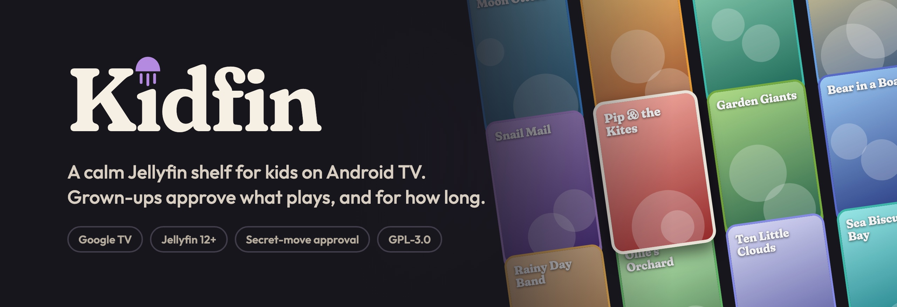
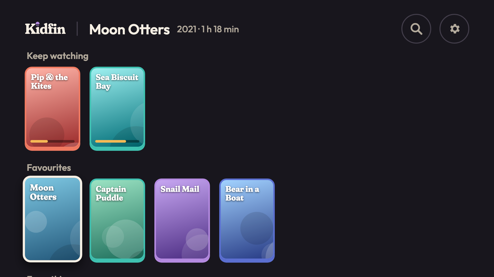
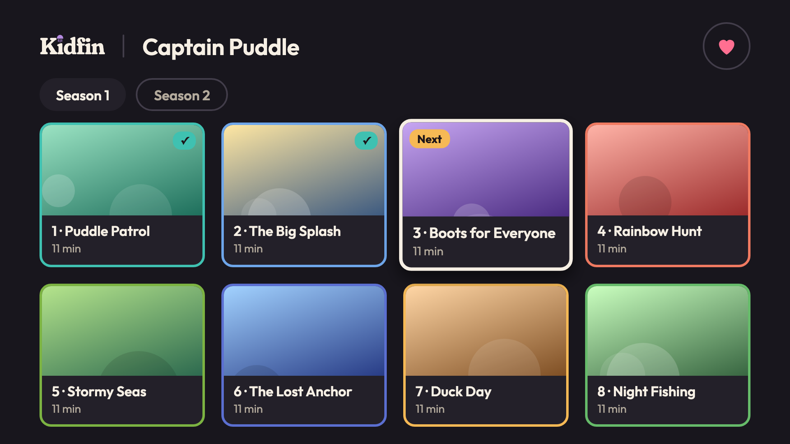
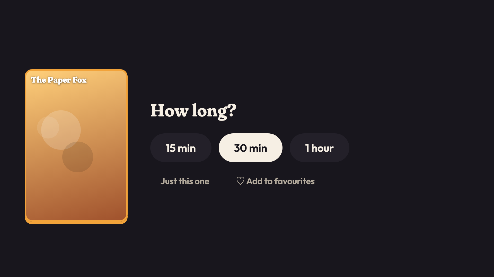
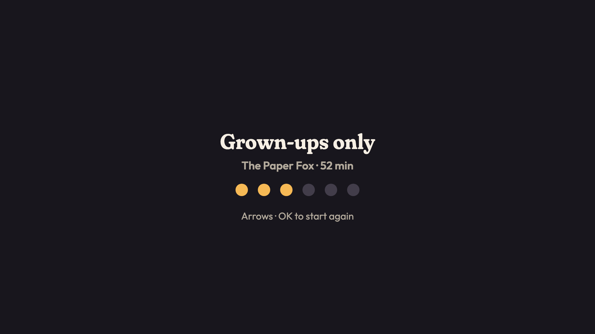

<p align="center">
  
</p>

<p align="center">
  <a href="https://github.com/N-Soder/kidfin/actions/workflows/ci.yml"></a>
  <a href="LICENSE"></a>
  
  
</p>

<p align="center">
  <a href="#features">Features</a> ·
  <a href="#setup">Setup</a> ·
  <a href="#keeping-children-in-kidfin">Keeping children in Kidfin</a> ·
  <a href="#build">Build</a> ·
  <a href="docs/decisions.md">Design notes</a>
</p>

# Kidfin

Kidfin is a children's front end for [Jellyfin](https://jellyfin.org) on Android TV and Google TV.
Kids see a shelf of the shows and films you chose. A grown-up approves what plays and for how
long, and when time is up the TV says goodbye and can turn itself off.

Kidfin is an independent project. It is not affiliated with or endorsed by the Jellyfin project.

## Screenshots

Mock-ups with made-up titles (a real shelf shows your library's artwork).

| Shelf | A show's episodes |
|---|---|
|  |  |
| **Grown-up approval** | **Secret moves** |
|  |  |

## Features

- **Content-first shelf.** Children browse posters, search by title and pick what they want.
  Rows for Keep watching, Favourites and a daily-shuffled Everything.
- **Grown-up approval.** Nothing plays until a grown-up approves it. The secret is six arrow
  presses on the remote, so a watching child cannot see which keys were used. Leaving Kidfin
  with Back also needs the secret.
- **Timed sessions.** Choose 15, 30 or 60 minutes (or "just this one"). Only time actually
  playing counts. The last title may run up to 3 minutes over. A grown-up can add 5, 10 or 15
  minutes, one extension per secret entry. Unused time locks after 30 idle minutes or a reboot.
- **Goodbye and TV standby.** When a session ends Kidfin shows a goodbye and locks. It can then
  put the TV to standby through an optional accessibility service that locks the screen, which
  makes a Chromecast with Google TV send a CEC standby command. Without the service Kidfin just
  locks.
- **Safe by default.** The child account is non-admin and limited to the libraries you pick.
  Admin accounts are refused.

## Threat model

Kidfin is a convenience barrier for a cooperative household, not tamper-proof parental control.
It stops a child reopening Kidfin without approval. It does not stop Home, other apps, other
inputs or uninstalling. Use Google TV kids profiles for that, install a release build, and turn
off developer options and network debugging on the TV.

If your Jellyfin server uses plain `http://`, the password (once, at sign-in) and the access token
(on every request) cross your network unencrypted. Kidfin allows this because most home servers
work that way, and warns on the sign-in screen. Use it only on a network you trust, or put the
server behind HTTPS. The token is stored encrypted with an Android Keystore key.

## Keeping children in Kidfin

Back on the shelf, Pick another and Resume asks for the secret before leaving Kidfin. The Home
button can't be blocked by an ordinary app, so lock down what Home leads to instead:

- **Google TV kids profile (recommended).** Create a kids profile on the TV and allow only Kidfin
  in it. Home then leads to a home screen with nothing else to open. Switching back to your own
  profile needs your Google account or PIN.
- **A third-party launcher.** If you use one, check whether it can hide other apps or open Kidfin
  on start-up.

## Requirements

- Android TV or Google TV device on Android 9 (API 28) or newer.
- Jellyfin server **12.0 or newer** (Jellyfin SDK 1.9.x does not support 10.11 and older).
- A non-admin Jellyfin account for the children.

## Setup

1. In Jellyfin, create a non-admin user for the children. Give it access only to the libraries
   you want them to see. Set its password.
2. Install Kidfin on the TV (see below) and open it. Choose the grown-up secret (six arrow
   presses, entered twice).
3. Choose the cog (Grown-ups), then Jellyfin, and enter the server address, the child account's
   username and its password.
4. Choose the libraries to show.
5. Optional: Grown-ups, then TV power, explains how to enable the "Kidfin TV power" accessibility
   service so the TV goes to standby after a session. Use the Test button to check your setup.

## Build

There is no downloadable APK yet: build from source and install with adb.

You need JDK 17 or newer and the Android SDK (platform `android-37.2`).

```sh
export JAVA_HOME=/path/to/jdk-17-or-newer
echo "sdk.dir=/path/to/android/sdk" > local.properties   # once; not committed
./gradlew testDebugUnitTest lintDebug assembleDebug
./gradlew assembleRelease
```

Outputs are under `app/build/outputs/apk/`. Install with
`adb install -r app/build/outputs/apk/release/app-release.apk`. Release builds are noticeably
faster than debug builds on a TV.

### Release signing

Set these as Gradle properties (for example in `~/.gradle/gradle.properties`) or environment
variables:

| Name | Meaning |
|---|---|
| `KIDFIN_KEYSTORE` | Path to your keystore file |
| `KIDFIN_KEYSTORE_PASSWORD` | Keystore password |
| `KIDFIN_KEY_ALIAS` | Key alias |
| `KIDFIN_KEY_PASSWORD` | Key password |

If `KIDFIN_KEYSTORE` is not set, `assembleRelease` falls back to the debug key so local builds
still work and upgrade over debug builds in place. **Do not distribute APKs built that way**;
anyone can sign an update with a debug key. Keep your keystore out of the repository
(`*.keystore` and `*.jks` are git-ignored). Switching signing keys requires uninstalling the app
first.

## Licence

Kidfin is free software under the [GNU GPL v3.0 or later](LICENSE).

Third-party components keep their own licences, including the Jellyfin Kotlin SDK (LGPL-3.0),
AndroidX, Media3, Coil and OkHttp (Apache-2.0), SLF4J (MIT) and the Fraunces and Outfit fonts
(SIL OFL 1.1). They are listed in
[`app/src/main/assets/licences/THIRD-PARTY.txt`](app/src/main/assets/licences/THIRD-PARTY.txt),
which also ships inside the app.

## Contributing

See [CONTRIBUTING.md](CONTRIBUTING.md). Design rationale is in [docs/decisions.md](docs/decisions.md)
and the manual test plan in [docs/testing.md](docs/testing.md). To report a vulnerability, see
[SECURITY.md](SECURITY.md).
